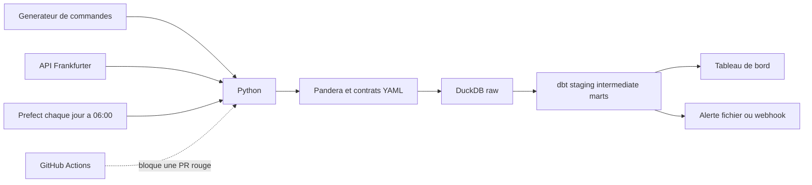

# Idée à défendre

## Problématique

La direction commerciale et la finance veulent un chiffre d'affaires quotidien comparable entre pays. Aujourd'hui, un doublon, un prix faux ou un taux manquant peut produire un montant faux, et personne ne sait d'où il vient.

La plateforme fait arriver les commandes et les taux toute seule, écarte les lignes invalides, convertit en euros, et prévient l'équipe si une journée sort de l'habitude.

Les commandes sont synthétiques. Elles reprennent la boutique des TP et ajoutent la devise.

## Sources

1. **Commandes** : générateur Python déterministe. Colonnes : `order_id`, `order_date`, `customer_id`, `country`, `product`, `quantity`, `unit_price`, `currency`, `data_origin = synthetique`.
2. **Taux** : API Frankfurter v2, sans clé. Base EUR, cotations USD, TND, MAD. Exemple vérifié : `https://api.frankfurter.dev/v2/rates?from=2026-10-01&to=2026-10-12&base=EUR&quotes=USD,TND,MAD`.

## Métiers

- Direction commerciale : ventes par pays.
- Finance : conversion et date réelle du taux utilisé.
- Responsables produits : produits en hausse ou en baisse, journées à vérifier.

## Questions

1. Quel est le chiffre d'affaires par jour, par mois et par pays, en euros ?
2. Quels produits et quels segments de clients contribuent le plus, et lesquels reculent ?
3. Quelles journées et quels pays s'écartent assez de leur médiane pour être vérifiés ?

## Conversion

Le taux Frankfurter `TND` est le nombre de dinars pour un euro. On **divise** le montant en dinars par ce taux. Pour l'euro, le taux vaut 1. Si le jour de la commande n'a pas de taux, on prend le dernier taux à cette date ou avant, et on garde la date réelle du taux (`fx_rate_date`).

## Schéma

Le détail des choix est dans `docs/architecture.md`.

## Au-delà du cours

Détection des journées anormales dans dbt : une journée est signalée si son chiffre d'affaires dépasse 2,5 fois la médiane du pays, ou tombe sous 0,4 fois cette médiane, à condition d'avoir au moins 7 jours. Le générateur plante un pic de chaises en Tunisie (10 novembre 2026, ou 8 octobre sur le jeu court) pour que l'alerte soit démontrable. Ce n'est pas un événement réel.

## Écart avec l'ancien cahier

Le PDF simplifié est la référence. Il n'exige pas le million de lignes, MinIO, Iceberg ni le déploiement AWS pour cette base. Ces points restent possibles plus tard. AWS ne sera fait qu'après le local, sans secret dans Git, avec une alerte de budget, et les ressources seront supprimées à la fin.
