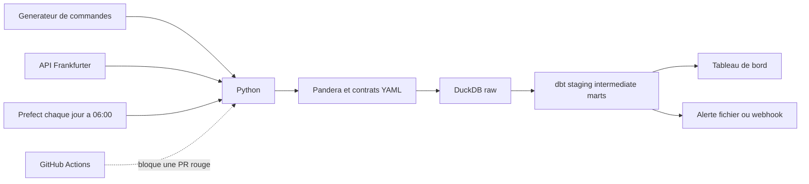

# Architecture

Python collecte et charge le brut. dbt transforme et teste. Prefect relance chaque jour. GitHub Actions empêche une modification cassée d'arriver sur `main`. Le tableau de bord lit les marts seulement si le dernier run est `success`.

## Choix

- **DuckDB** : entrepôt du niveau 1, un fichier `data/warehouse.duckdb`.
- **dbt** : staging, intermediate, marts. Dix-sept modèles, dont la table de faits, quatre dimensions et les marts métier.
- **Prefect** : le flow `ventes-quotidiennes` exécute le pipeline. En cas d'échec, la tâche est relancée deux fois. Le conteneur `scheduler` attend 06:00 puis appelle ce flow.
- **Qualité** : un contrat YAML par source, Pandera sur la forme, quarantaine `int_orders_rejected`, tests dbt qui font échouer `dbt build`.
- **Alerte** : `data/alerts/latest_alert.json`. Si `ALERT_WEBHOOK_URL` est rempli, le même message est envoyé. L'URL n'est pas dans Git.
- **Anomalies** : règle de médiane dans `mart_sales_anomalies`, plutôt qu'un modèle difficile à expliquer pendant la soutenance. Le pic est synthétique et documenté.

## Clés

- Commande : `order_id`.
- Taux : `rate_date`, `base_currency`, `quote_currency`.

Une deuxième exécution supprime ces clés puis les réinsère. Le nombre de clés ne change pas. `_loaded_at` est mis à jour : c'est l'heure du chargement, pas une nouvelle vente.

## Couches

| Couche | Rôle |
|---|---|
| `raw` | Texte reçu, y compris les lignes fausses |
| staging | Types, pays remis au propre, un taux par clé |
| intermediate | Rejet, conversion EUR, taux manquant |
| marts | Faits, dimensions, réponses métier |

Les montants publiés sont en `DECIMAL`. Le taux étranger divise le montant local.
